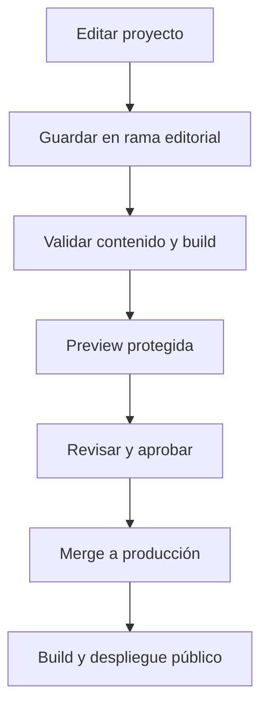

# aggiovato — Especificación de producto, diseño y arquitectura del portfolio

**Versión:** 1.0 · **Fecha:** 9 de noviembre de 2026  
**Documento:** propuesta de implementación; no representa una aplicación ya construida.  
**Idioma del documento:** español. **Idioma inicial del sitio:** inglés.  
**Identidad:** aggiovato, marca personal de desarrollo cuyo significado intencional es «aterrizado en Júpiter».

## 1. Decisión principal

Construir un portfolio editorial con **Astro + TypeScript**, contenido estructurado y páginas independientes para cada proyecto. Priorizar generación estática, navegación web convencional y mejoras interactivas pequeñas. Utilizar el logo orgánico de la A-cohete, una paleta oscura violeta y una dirección artística inspirada en Júpiter y en herramientas de desarrollo.

El objetivo no es simular una nave que haya que aprender a manejar: es mostrar con claridad qué sabes construir, cómo tomas decisiones y qué aportas a un producto. La exploración espacial da carácter; los casos de estudio aportan credibilidad.

**Recomendación para contenido:** comenzar con archivos versionados y añadir **Keystatic como interfaz de edición**, inicialmente en local si se quiere acelerar el lanzamiento y en modo GitHub para editar desde un navegador cuando esa necesidad esté validada. No construir un panel propio en la primera versión.

**Recomendación para publicación:** sitio público prerenderizado servido mediante CDN. Si el editor se despliega dentro de la misma aplicación, sus rutas y endpoints necesitan ejecución de servidor con un adaptador compatible. Que exista un admin dinámico no obliga a renderizar todo el portfolio en cada visita.

### Qué significa «server side» aquí

| Modelo | Cuándo se produce el HTML | Aplicación propuesta |
|---|---|---|
| SSG / prerender | Durante el build | Home, proyectos, about y contenido editorial |
| SSR bajo demanda | Al solicitar una ruta | Editor online, autenticación y previews privadas, si se implementan |
| JavaScript del navegador | Tras cargar la página | Menú, filtros, copiar código y pequeñas animaciones |

Astro permite combinar prerender y rutas bajo demanda mediante adaptadores [S1]. Para un portfolio que cambia unas pocas veces al mes, reconstruir al publicar suele ser más sencillo que mantener consultas dinámicas para cada visitante. «Poco JavaScript» y «SSR» no son sinónimos: el primero es un objetivo de entrega; el segundo, una decisión sobre cuándo renderizar.

## 2. Objetivos, audiencias y criterios de éxito

### Audiencias

1. **Responsable técnico:** quiere entender arquitectura, decisiones, calidad y alcance real de tu contribución.
2. **Recruiter:** necesita identificar rol, tecnologías, experiencia, ubicación profesional si decides mostrarla y vías de contacto.
3. **Cliente o responsable de producto:** busca pruebas de que puedes convertir un problema en una solución usable.
4. **Desarrollador de la comunidad:** quiere descubrir proyectos abiertos, documentación y herramientas.

### Recorrido principal

En la primera pantalla debe ser evidente que eres full-stack developer, con especial atención a frontend y producto. En una interacción debe poder abrirse un proyecto. En su página, el visitante debe reconocer el problema, tu participación y el resultado sin tener que leer todo el artículo.

### Objetivos verificables

- Identidad y rol visibles antes de hacer scroll en un móvil habitual.
- Enlace a proyectos y contacto inmediatamente disponible.
- Cada proyecto destacado tiene URL propia y un resumen de menos de 100 palabras.
- Toda afirmación de impacto distingue resultados medidos, observaciones cualitativas y objetivos aún no alcanzados.
- El contenido principal sigue disponible sin JavaScript.
- Crear un proyecto nuevo no exige cambiar componentes ni añadir manualmente una ruta.
- El diseño puede mantenerse sin convertir cada proyecto en una página artesanal.

No usar commits, estrellas ni años de experiencia como sustituto de evidencia de calidad. Mostrar métricas únicamente cuando sean correctas, relevantes y se pueda explicar cómo se obtuvieron.

## 3. Dirección creativa: Jovian development station

### Idea central

**Grounded in code. Built to explore.**

La frase conecta ingeniería, curiosidad y el origen de la marca. La portada mezcla una composición editorial amplia con detalles de editor: un pequeño nombre de archivo, numeración discreta y fragmentos de código reales o claramente decorativos.

La personalidad buscada es curiosa, competente, cercana y meticulosa. Evitar estética militar, interfaces de videojuego saturadas, neón omnipresente o una terminal obligatoria para navegar.

### Qué conservar del mockup

- Fondo grafito, letras claras y acentos lavanda.
- Logo orgánico en la navegación.
- Titular grande a la izquierda y Júpiter parcialmente recortado a la derecha.
- Una trayectoria fina con una versión pequeña del logo.
- Proyectos inmediatamente después del hero.
- Combinación de tipografía de lectura y monoespaciada para metadatos.

### Qué cambiar al implementarlo

La imagen generada es una referencia artística, no una especificación de píxeles ni una fuente de datos. No copiar las coordenadas decorativas como información científica, el YAML ilustrativo como documentación real de yRest ni las pantallas ficticias como capturas de un producto entregado.

Sustituir los previews por material real o por reconstrucciones claramente identificadas. Reducir la cantidad de elementos pequeños. Dar al texto más protección frente al planeta. Evitar reproducir la imagen entera como fondo: separar tipografía, botones, planeta, trayectoria y proyectos en elementos independientes.

### Metáfora espacial en dosis pequeñas

Usar términos estándar en navegación: **Work, About, Lab, Contact**. Reservar el lenguaje espacial para pequeños títulos y detalles, por ejemplo «Arrival point», «Mission notes» o «Flight log». Las personas no deberían adivinar que «Hangar» significa proyectos o que «Transmission» significa contacto.

## 4. Marca y recursos gráficos

### Logo

Vectorizar el símbolo A-cohete aprobado, conservando su contorno orgánico. Preparar:

- Símbolo sin texto.
- Lockup horizontal con «aggiovato».
- Versión monocroma negra y blanca.
- Variante lavanda para fondos oscuros.
- Favicon simplificado y avatar cuadrado.

El símbolo pequeño debe conservar huecos suficientes. Evaluar a 16, 24, 32 y 48 px. Si el hueco interior o los extremos de las aletas se cierran, crear una variante óptica simplificada, no limitarse a reducir el SVG principal.

Mantener un área libre alrededor equivalente aproximadamente a un cuarto de la altura del símbolo. No animar permanentemente el logo principal ni deformarlo con efectos líquidos. El pequeño cohete decorativo del hero puede usar el mismo lenguaje, sin competir con la firma de navegación.

### Assets de Júpiter

Crear un recorte propio del planeta con bandas cálidas y violetas, sin anillos prominentes que lo hagan parecer Saturno. Para el MVP basta una imagen optimizada con transparencia o un fondo que se funda correctamente con el hero.

Preparar versiones desktop y mobile con composición distinta. La versión móvil puede mostrar sólo un arco de la atmósfera; no necesita contener el planeta completo. Preferir formatos modernos y dimensiones adecuadas al espacio real. Separar la trayectoria en SVG y dejar el planeta como recurso raster.

No es necesario WebGL para lograr esta dirección visual. Una representación 3D real sería una mejora posterior, sujeta a rendimiento y accesibilidad.

## 5. Paleta propuesta

Los colores siguientes son tokens de diseño recomendados; verificar el contraste final en todas las combinaciones y estados reales, especialmente sobre imágenes y transparencias.

| Token | Hex | Uso |
|---|---|---|
| `--color-bg` | `#12131A` | Fondo principal |
| `--color-surface` | `#1B1D28` | Tarjetas, menús, paneles |
| `--color-surface-raised` | `#252838` | Hover, bloques destacados |
| `--color-text` | `#F5F2FA` | Texto principal |
| `--color-text-muted` | `#B9B5C9` | Descripciones y metadatos |
| `--color-text-subtle` | `#9691A8` | Información secundaria legible |
| `--color-brand` | `#7950E8` | Marca y elementos gráficos |
| `--color-accent` | `#C6A5FF` | Enlaces y CTA claros |
| `--color-accent-hover` | `#D8C1FF` | Hover del CTA |
| `--color-on-accent` | `#1B122C` | Texto sobre botón lavanda |
| `--color-jupiter` | `#E8AE91` | Detalles cálidos del planeta |
| `--color-success` | `#9DDDBB` | Confirmaciones |
| `--color-error` | `#FFB4BC` | Errores de formularios |
| `--color-border` | `#363344` | Separadores decorativos |
| `--color-control-border` | `#827B94` | Contornos funcionales |
| `--color-focus` | `#E8AE91` | Foco visible de teclado |

### Reglas de aplicación

- La mayor parte de la pantalla debe ser neutra: fondo, superficies y texto.
- Reservar lavanda para acciones importantes y puntos de atención.
- Usar melocotón como acento pequeño, principalmente asociado al planeta.
- El botón principal será lavanda con texto oscuro; no asumir que blanco sobre cualquier violeta tiene contraste suficiente.
- No comunicar estado sólo por color: acompañarlo con texto e icono cuando corresponda.
- Los bordes decorativos pueden ser sutiles; los límites de controles deben seguir siendo identificables.
- Mantener las capturas de cada producto con sus colores reales, dentro de un marco coherente con el portfolio.

### Modo claro

No lo haría obligatorio para el primer lanzamiento. Primero terminaría un modo oscuro excelente. Si se añade, usar fondo `#FAF8FD`, superficie `#FFFFFF`, texto `#242033`, texto secundario `#625B73` y acento `#6333C4`. Ajustar también el planeta, los bordes y los estados; invertir el fondo no produce por sí solo un modo claro correcto.

## 6. Tipografía, espaciado y componentes

### Tipografías propuestas

- **Manrope** para títulos y cuerpo: geométrica, amable y compatible con las curvas del símbolo.
- **JetBrains Mono** para código, etiquetas cortas, rutas y datos técnicos.

Confirmar licencia de los archivos elegidos y alojar fuentes WOFF2 localmente. Cargar sólo estilos necesarios. No poner párrafos largos en monoespaciada.

### Escala inicial

| Elemento | Mobile | Desktop |
|---|---:|---:|
| H1 home | 40–48 px | 64–88 px |
| H1 proyecto | 36–44 px | 56–72 px |
| H2 | 28–32 px | 36–48 px |
| Texto principal | 16–18 px | 17–18 px |
| Metadatos | 12–14 px | 13–14 px |
| Código | 13–14 px | 14–15 px |

Son rangos de partida, no tamaños que deban aplicarse sin revisar la longitud del texto. Usar `clamp()` y limitar el ancho de títulos por caracteres. Cuerpo con interlineado cercano a 1.6; titulares aproximadamente 1.05–1.15. Longitud de lectura del caso de estudio: alrededor de 65–75 caracteres por línea.

Espaciado base: 4, 8, 12, 16, 24, 32, 48, 64, 96 y 128 px. Radio de controles: 10–14 px; tarjetas: 18–24 px. No todas las superficies necesitan un borde y una sombra.

### Componentes reutilizables

| Componente | Responsabilidad |
|---|---|
| `SiteHeader` | Marca, navegación, menú móvil |
| `SiteFooter` | Contacto, redes y enlaces secundarios |
| `Hero` | Propuesta de valor y CTA |
| `JupiterScene` | Ilustración decorativa y trayectoria |
| `ProjectCard` | Preview, resumen y enlace de caso |
| `ProjectMeta` | Rol, estado, periodo y contexto |
| `TechList` | Tecnologías agrupadas por función |
| `DecisionBlock` | Decisión, alternativas y trade-off |
| `MediaFigure` | Imagen, alt y pie de foto |
| `CodeBlock` | Código, lenguaje y acción de copiar opcional |
| `TableOfContents` | Navegación dentro de casos extensos |
| `Callout` | Restricciones, aprendizajes o avisos editoriales |
| `ContactCTA` | Acción final de contacto |

Los componentes deben aceptar datos; no contener excepciones arbitrarias para cada proyecto. Una variante especial debe responder a una necesidad repetible.

## 7. Arquitectura de información y rutas

| Ruta | Contenido | Lanzamiento |
|---|---|---|
| `/` | Presentación y selección de trabajo | Sí |
| `/work/` | Índice completo de proyectos | Sí |
| `/work/[slug]/` | Caso de estudio individual | Sí |
| `/about/` | Perfil, experiencia y forma de trabajar | Sí |
| `/contact/` | Canales de contacto | Sí, sencilla |
| `/lab/` | Experimentos y herramientas pequeñas | Cuando haya contenido |
| `/lab/[slug]/` | Detalle o demo de un experimento | Posterior |
| `/notes/` | Publicaciones técnicas | Posterior |
| `/notes/[slug]/` | Artículo | Posterior |
| `/404` | Error útil con regreso a navegación | Sí |
| `/keystatic/` | Interfaz editorial si se incorpora | Opcional |

No mostrar secciones vacías en el menú. Elegir `/work/` como nombre canónico y mantenerlo estable. Si se cambia un slug publicado, crear una redirección permanente al nuevo.

La URL de proyecto debe ser real, compartible y navegable con atrás/adelante. No sustituir el caso de estudio por un modal. Los enlaces de demo y repositorio son acciones adicionales, no reemplazos de la explicación.

## 8. Home: contenido y comportamiento

### 8.1 Navegación

Logo a la izquierda. Enlaces principales a la derecha. GitHub puede aparecer como icono con nombre accesible. Cabecera de 72–80 px en desktop y 64–72 px en móvil. Si se hace sticky, utilizar fondo suficientemente opaco y compensar el scroll a anclas.

### 8.2 Hero

Texto inicial propuesto:

> Grounded in code. Built to explore.
>
> Alejandro Lugo · Full-stack developer
>
> Thoughtful interfaces. Reliable systems. Ideas brought to life.

CTA principal: **Explore my work**. Secundario: **Let's talk**. No mostrar «Available for hire» sin confirmar que refleja la situación actual.

Distribución desktop aproximada: 55 % texto y 45 % escena gráfica, ajustada según el ancho real. La imagen no debe invadir el área de lectura. Los números de línea y la ruta `portfolio / introduction.ts` son decoración y pueden ocultarse a tecnologías de asistencia.

### 8.3 Selected work

Mostrar 2–4 proyectos, ordenados manualmente por relevancia. Cada tarjeta incluye título, descripción de una frase, preview, dos o tres categorías y enlace al caso. El título y la imagen pueden enlazar al mismo destino, evitando enlaces anidados y áreas interactivas ambiguas.

Para este perfil, yRest sería un candidato claro por ser una herramienta propia. El trabajo de sistemas de reservas puede demostrar dominio de producto, pero sólo con contenido autorizado, capturas limpias y separación de responsabilidades personales y del equipo.

### 8.4 Forma de trabajar

Bloque breve con tres ideas: entender el problema, diseñar la solución y construir/iterar. Usar ejemplos del trabajo, no frases genéricas sobre pasión o innovación.

### 8.5 Perfil y contacto

Resumen de 80–120 palabras enlazado a About. Cierre con una invitación específica: «Have a product worth building? Let's talk.» Mantener contacto accesible también desde el footer.

## 9. Responsive: no reducir simplemente la maqueta

### Puntos de adaptación propuestos

| Anchura | Layout |
|---|---|
| 320–479 px | Una columna, márgenes 16–20 px, controles apilados si hace falta |
| 480–767 px | Una columna amplia, márgenes 24 px |
| 768–1023 px | Tablet; dos columnas sólo si el contenido lo permite |
| 1024–1439 px | Hero dividido, tarjetas en dos columnas |
| 1440 px o más | Contenedor centrado, máximo aproximado 1280–1360 px |

Los breakpoints se eligen por roturas del contenido, no por un modelo concreto de dispositivo. Usar grid fluido, `minmax()`, `clamp()` y container queries cuando una tarjeta necesite adaptarse a su propio espacio.

### Desktop

- Mostrar la escena de Júpiter en el lateral, recortada dentro del hero.
- Evitar un hero fijo de 100vh que esconda todos los proyectos.
- Cabecera completa y CTA visibles.
- Proyectos con previews suficientemente grandes para apreciar la interfaz.
- Caso de estudio con contenido central y un índice lateral discreto cuando sea largo.

### Mobile

- Orden: marca/navegación, identidad profesional, titular, descripción, CTA y gráfica.
- No colocar una imagen de planeta gigante antes de explicar quién eres.
- Júpiter como recorte inferior de 180–240 px de alto o detalle de fondo protegido por una superficie opaca.
- Ocultar fragmentos de código decorativos y coordenadas si compiten con lectura.
- Proyectos en lista vertical, con preview arriba y contenido debajo.
- Las chips deben envolver líneas; nunca forzar scroll horizontal de toda la página.
- Menú mediante botón con estado expandido, cierre por Escape y gestión de foco si se comporta como diálogo.
- Mantener objetivos táctiles de al menos 44 × 44 px como criterio de diseño.
- No depender de hover: títulos, enlaces y acciones permanecen visibles.
- Índice del caso como desplegable «On this page», no una columna comprimida.
- Código puede tener scroll horizontal dentro de su propio bloque; texto editorial no.
- Respetar safe areas y evitar barras fijas que tapen contenido o teclado virtual.

### Comportamientos adicionales

Con zoom y fuentes grandes, el layout debe reordenarse. Reservar dimensiones para imágenes. Usar capturas móviles reales cuando existan; una captura desktop reducida a 320 px puede ser ilegible. Ofrecer ampliación accesible o dividirla en detalles relevantes.

## 10. Página de proyecto: un caso de estudio útil

Cada proyecto debe responder a «qué hiciste», «por qué», «cómo» y «qué aprendiste». Evitar una simple galería con badges.

### Estructura editorial

1. **Cabecera:** título, resumen y una imagen representativa.
2. **Ficha rápida:** tipo, periodo, estado, rol y equipo/contexto.
3. **Problema:** usuarios afectados, proceso anterior y limitaciones.
4. **Objetivo:** qué se intentaba mejorar y cómo se evaluaría.
5. **Tu contribución:** responsabilidades concretas y límites.
6. **Solución:** flujo principal y experiencia del usuario.
7. **Decisiones técnicas:** stack, alternativas, razones y costes.
8. **Arquitectura:** diagrama pequeño cuando aclare relaciones.
9. **Detalles de implementación:** uno o dos retos bien explicados.
10. **Validación:** pruebas, feedback y resultados verificables.
11. **Aprendizajes:** qué harías distinto y qué queda pendiente.
12. **Enlaces:** demo, código y documentación cuando existan.
13. **Siguiente proyecto:** recomendación editorial, no carrusel obligatorio.

No todos los proyectos requieren 13 secciones visibles. Un proyecto pequeño puede combinar varias y mantener una lectura de 3–5 minutos. Un caso principal puede tener una lectura más larga. Omitir secciones sin información es preferible a rellenarlas con texto genérico.

### Cómo explicar el stack

| Capa | Tecnología | Razón | Coste o alternativa |
|---|---|---|---|
| Interfaz | Angular / React según el proyecto real | Organización, ecosistema o requisitos | Complejidad asumida |
| API | Tecnología utilizada | Contratos, negocio o integración | Operación y mantenimiento |
| Datos | Solución utilizada | Persistencia y consultas | Consistencia, migraciones |
| Calidad | Herramientas utilizadas | Riesgos que cubren | Tiempo y alcance |

No incluir una tecnología porque esté instalada indirectamente. Diferenciar «utilizada en producción», «prototipo» y «exploración».

### Plantilla narrativa de una decisión

> **Problema:** las peticiones podían terminar fuera de orden.
>
> **Decisión:** coordinar el flujo para que la interfaz mostrara el resultado pertinente.
>
> **Alternativas:** serializar todo o permitir concurrencia sin descartar respuestas antiguas.
>
> **Trade-off:** qué operaciones pueden cancelarse y cuáles deben completarse.
>
> **Evidencia:** prueba o comportamiento observado.

Adaptar siempre al proyecto real; este texto es una plantilla, no una afirmación sobre una implementación existente.

### yRest como caso inicial

Explicar el bloqueo de frontend sin API disponible, el enfoque YAML, la experiencia CLI, los contratos de rutas y las decisiones sobre consultas. Incorporar un ejemplo real extraído de documentación vigente. Incluir demo controlada o vídeo breve, enlace al repositorio y límites del mock frente a un backend real. No inventar estadísticas de adopción.

### Proyectos de empresa

Usar datos ficticios y material autorizado. Se puede explicar una decisión sin revelar endpoints, credenciales, precios, información de clientes ni código privado. Identificar el papel personal con precisión. Si el producto no es público, usar un estado como «Private product» y no colocar un botón de demo que no funciona.

## 11. Stack recomendado

| Área | Elección inicial | Justificación de diseño |
|---|---|---|
| Framework | Astro | Encaje con contenido y páginas independientes |
| Lenguaje | TypeScript en modo estricto | Contratos de datos y mantenimiento |
| Componentes públicos | `.astro` y HTML semántico | Reducir hidratación innecesaria |
| Estilos | CSS con tokens; Tailwind opcional | Control visual sin sistema pesado |
| Contenido | Content Collections + Markdoc | Estructura validable y edición CMS |
| Editor | Keystatic | Interfaz editorial sobre contenido en Git |
| Interactividad compleja | Islas React puntuales | Aprovechar experiencia existente sólo donde aporte |
| Iconos | Un único conjunto SVG | Coherencia y entrega ligera |
| Calidad | Astro check, lint, build y Playwright | Verificar rutas y comportamientos principales |
| Despliegue | Hosting con CDN y adaptador Astro compatible | Prerender público y servidor sólo cuando haga falta |

No añadir Angular a este sitio sólo porque sea tu stack profesional principal. Puedes demostrar Angular con los proyectos. Tampoco necesitas un backend Spring Boot, un store global, GraphQL o una base de datos para una colección editorial pequeña.

Si prefieres Tailwind, mantener las decisiones de color, espacio y tipografía en tokens. Evitar clases ad hoc que generen diez estilos distintos de tarjeta. No instalar simultáneamente varias librerías de animación o componentes.

### Islas y estado

Usar scripts pequeños para menú y copiar código. Reservar React para un playground, un buscador complejo o una interfaz interactiva de verdad. Los filtros de proyectos pueden vivir en la URL; no requieren un store global. El contenido de las tarjetas debe llegar en HTML, no aparecer únicamente después de hidratar.

## 12. Modelo de contenido y organización

Astro dispone de colecciones para organizar contenido local o remoto y generar páginas a partir de sus entradas [S2]. Para esta propuesta, elegir colecciones de build, no datos vivos por petición.

### Colecciones

- `projects`: casos de estudio.
- `technologies`: nombres y categorías reutilizables cuando la lista lo justifique.
- `notes`: artículos, cuando se active esa sección.
- `experiments`: piezas de Lab.
- `siteSettings`: datos globales, enlaces y configuración editorial.

### Contrato de Project

| Campo | Tipo conceptual | Regla |
|---|---|---|
| `id` | string estable | No cambia al editar el título |
| `slug` | string | Único; sólo caracteres de URL permitidos |
| `title` | string | Obligatorio |
| `summary` | string | Breve, útil fuera de contexto |
| `publicationStatus` | draft / published / archived | Separado del estado del producto |
| `projectStatus` | active / completed / prototype / paused | Describe el proyecto |
| `featured` | boolean | Selección para home |
| `featuredOrder` | number | Orden explícito |
| `projectType` | personal / open-source / professional | Contexto |
| `role` | string[] | Responsabilidades reales |
| `periodLabel` | string | Evita precisión falsa sobre fechas |
| `publishedAt` | fecha | Obligatoria al publicar |
| `updatedAt` | fecha | Cambios editoriales relevantes |
| `stack` | lista estructurada | Tecnología, capa y razón |
| `cover` | asset + alt | Requerida al publicar |
| `gallery` | lista | Imágenes con pie y texto alternativo |
| `links` | objeto | Demo, código y docs, opcionales |
| `seo` | objeto | Título y descripción si difieren del contenido |
| `body` | Markdoc | Caso de estudio |

Definir `archived` como no listado públicamente en el MVP, y conservar su ruta anterior con una decisión explícita: redirección o retirada. Si se quiere mantener proyectos históricos accesibles, usar otro campo `listed` y documentar su interacción con el estado.

### Ejemplo de metadatos orientativo

```yaml
id: yrest
slug: yrest
title: yRest
summary: A YAML-driven mock API for frontend development.
publicationStatus: draft
projectStatus: active
projectType: open-source
featured: true
featuredOrder: 1
role:
  - Product design
  - Development
periodLabel: "To be confirmed"
stack:
  - name: Node.js
    layer: runtime
    rationale: "Complete with the actual project decision."
cover:
  src: /media/projects/yrest/cover.webp
  alt: "Replace with an accurate description of the final screenshot."
links: {}
```

Es una representación conceptual del contrato, no una promesa sobre la serialización exacta de Keystatic. Configurar el editor y el loader para que lean y escriban el mismo formato. No publicar placeholders.

### Árbol de responsabilidades

| Ubicación | Contenido |
|---|---|
| `src/pages/` | Rutas públicas y endpoints propios |
| `src/layouts/` | Base, proyecto y artículo |
| `src/components/` | Componentes visuales reutilizables |
| `src/content/projects/` | Entradas editoriales |
| `src/content.config.ts` | Esquemas y loaders compatibles con la versión elegida |
| `src/lib/content/` | Consultas, filtrado público y normalización |
| `src/styles/` | Tokens, estilos globales y utilidades |
| `src/assets/` | Assets procesados por el build cuando corresponda |
| `public/media/` | Recursos publicados directamente |
| `keystatic.config.ts` | Campos del editor |
| `tests/` | Pruebas de flujos y validación |

Los recursos dentro de `public/` se publican tal cual. No asumir que Astro optimiza automáticamente todas las imágenes subidas por el editor; configurar el recorrido de assets y verificar el resultado.

## 13. Panel admin: qué haría y qué evitaría

### Comparativa

| Opción | Ventajas | Costes | Encaje |
|---|---|---|---|
| Archivos + Git | Mínima infraestructura, historial, revisión | Edición menos cómoda desde móvil | Excelente primer paso |
| Keystatic + Git | Formularios de edición y archivos versionados | Integración, permisos y rebuild | Opción recomendada |
| CMS externo | Gestión de medios y flujos editoriales más amplios | Dependencia, integración y condiciones del proveedor | Si el contenido crece mucho |
| Admin propio | Control total y proyecto demostrable | Auth, editor, datos, backups, permisos y mantenimiento | Sólo con objetivo adicional claro |

Keystatic ofrece integración con Astro y almacenamiento conectado a GitHub [S3][S4]. El panel no debe confundirse con una base de datos ni con publicación instantánea: en esta arquitectura, editar guarda contenido y desplegar actualiza la web pública.

### Alcance del editor recomendado

- Crear y editar proyectos.
- Completar metadatos con validación.
- Añadir imágenes, alt y pies de foto.
- Reordenar destacados.
- Gestionar borrador/publicado.
- Previsualizar un cambio antes de publicarlo, mediante un flujo configurado.

No implementar inicialmente roles para múltiples equipos, comentarios, likes, gestión de usuarios públicos, analítica interna propia ni editor de código arbitrario.

### Flujo editorial propuesto



Este flujo es el objetivo de configuración, no una afirmación de que el CMS trae todas esas etapas listas sin integración. Comprobar soporte de ramas, permisos y previews en la combinación concreta elegida. Para un único autor, se puede empezar con commits directos y revisión manual, manteniendo las validaciones antes del despliegue.

### Local frente a online

**Editor local:** arrancas el proyecto, entras al editor y guardas en archivos locales; después haces commit y despliegas. La web pública puede ser completamente estática.

**Editor online:** el servidor gestiona rutas de edición y autenticación; el almacenamiento usa GitHub o la configuración soportada elegida. No escribir contenido en el filesystem efímero del hosting esperando persistencia. Verificar callbacks, secretos y compatibilidad del adaptador.

En la aplicación con editor online, usar la configuración de renderizado soportada por las versiones fijadas. Una opción es salida de servidor y `prerender = true` en las rutas públicas. No copiar literalmente configuraciones antiguas con `output: 'hybrid'` sin comprobar su vigencia [S1][S3].

### Seguridad y borradores

- Autorizar por identidad estable del propietario, no sólo por «ha iniciado sesión».
- Proteger endpoints de escritura además de la pantalla del admin.
- Mantener secretos fuera del bundle cliente y de variables públicas.
- Aplicar permisos mínimos al repositorio.
- Filtrar borradores desde una función común utilizada por rutas, sitemap, feeds, búsqueda y proyectos relacionados.
- No generar una ruta de borrador esperando que `noindex` la mantenga privada.
- Proteger previews si contienen trabajo no publicado.
- Un borrador en un repositorio público sigue siendo visible en Git aunque no salga en la web.
- Los medios en `public/` pueden ser accesibles aunque el proyecto sea borrador: no guardar ahí material confidencial.

### Si más adelante se construye un admin propio

Diseñarlo como producto separado o módulo claramente aislado. Usar autenticación mantenida, autorización de un único propietario, almacenamiento persistente de contenido y almacenamiento de objetos para medios. Incorporar auditoría, control de versiones concurrentes, backups probados, protección de mutaciones, validación de uploads y estados de publicación.

Para mantener el frontend estático, publicar dispara un build seguro. Si se requiere publicación inmediata, valorar SSR para contenido y una política de caché explícita. Astro Actions y Sessions pueden aportar piezas de servidor [S5][S6], pero no sustituyen por sí solas todo el sistema de identidad ni un CMS.

## 14. Publicación, previews y errores

Propuesta operativa:

1. Repositorio con rama principal protegida y lockfile.
2. Comprobaciones de esquema, enlaces internos y build en cada cambio.
3. Preview por cambio editorial cuando el proveedor lo permita.
4. Publicación de la nueva versión sólo si el build termina correctamente.
5. Conservación de la última versión válida ante fallos.
6. Historial suficiente para revertir cambios de contenido y código.

Fijar versiones compatibles de Astro, adaptador, React del editor y Keystatic durante el arranque. Las guías pueden mostrar configuraciones de generaciones diferentes. Hacer una prueba pequeña de «editar → guardar → desplegar → ver proyecto» antes de desarrollar todo el diseño.

No elegir hosting únicamente por una cuota gratuita anunciada. Comprobar soporte del adaptador, funciones de servidor si hay editor online, previews privadas, límites de build, dominio y costes reales vigentes. Este documento no presupone un proveedor contratado.

## 15. Movimiento e interacción

| Elemento | Comportamiento | Mobile / movimiento reducido |
|---|---|---|
| Logo principal | Estático | Estático |
| Cohete del hero | Desplazamiento breve al entrar, opcional | Estático |
| Planeta | Movimiento visual muy leve y limitado | Imagen estática |
| Botones | Color y desplazamiento de 1–2 px | Sin depender de hover |
| Tarjetas | Cambio de borde o imagen sutil | Toda información visible |
| Entrada de secciones | Opacidad/traslación mínima | Aparición directa |
| Transición de páginas | Mejora opcional | Navegación normal válida |

No usar scroll hijacking, cursores personalizados obligatorios, pantallas de carga ficticias, sonido automático ni animaciones que retrasen lectura. La web debe ofrecer el contenido antes de que termine cualquier efecto.

Aplicar `prefers-reduced-motion`. Si existe movimiento continuo prolongado, ofrecer mecanismo de pausa o eliminarlo. No hacer animación del planeta con filtros costosos sobre toda la pantalla. Si las view transitions se incorporan, revisar foco, navegación atrás y limpieza de listeners.

## 16. Accesibilidad y rendimiento

### Accesibilidad

Objetivo de diseño: WCAG 2.2 AA, pendiente de auditoría real. Estructura semántica, un H1 por página, orden lógico de títulos, skip link, foco visible, enlaces descriptivos y menú operable con teclado.

Planeta y partículas son decorativos: `alt=""` o semántica equivalente cuando corresponda. Capturas de proyectos necesitan descripciones útiles, y los diagramas deben tener explicación textual. No ocultar contenido esencial detrás de tooltips. Revisar contraste de estados disabled, hover y focus además del estado normal.

### Presupuestos propuestos, no mediciones

| Recurso o métrica | Objetivo inicial |
|---|---|
| JS propio inicial de home | Aproximadamente ≤ 50 KB comprimidos |
| Imagen hero móvil | Aproximadamente 100–180 KB, según calidad visible |
| Imagen hero desktop | Aproximadamente 200–350 KB |
| LCP | Objetivo ≤ 2.5 s en condiciones representativas |
| INP | Objetivo ≤ 200 ms cuando haya datos de campo suficientes |
| CLS | Objetivo ≤ 0.1 |

Estos números son presupuestos internos. Medir en dispositivos y redes representativos; un resultado de laboratorio aislado no acredita la experiencia real. La home no debe descargar el bundle del editor.

Optimizar imágenes, reservar relación de aspecto, cargar diferido lo que esté bajo el primer viewport y no diferir automáticamente el recurso principal de LCP. Priorizar únicamente lo necesario. Limitar fuentes y evitar vídeos de reproducción automática en la portada.

## 17. SEO, idiomas y compartir

Cada proyecto tendrá título, descripción, canonical, imagen social y un enlace rastreable desde `/work/`. Generar sitemap sólo con páginas públicas. No indexar editor, búsquedas internas ni previews. `robots.txt` no es una medida de autenticación.

Crear tarjetas Open Graph con logo, título y una captura o gráfico del proyecto. Deben seguir legibles fuera del sitio. Usar datos estructurados acordes al contenido real, por ejemplo perfil personal y trabajos creativos, sin añadir reseñas o acreditaciones inexistentes.

Comenzar en inglés para mantener la calidad editorial. Si se añade español, decidir una estrategia consistente de rutas y traducciones antes de implementarla. Un selector de idioma no debería enviar siempre a la home: conservar el proyecto equivalente cuando exista. Mantener IDs estables entre traducciones y `hreflang` correcto. No duplicar URLs en inglés sin una razón editorial.

## 18. Contacto y observación del uso

Para el MVP: email visible, enlace de correo y perfiles profesionales verificados. Un formulario es opcional, no un requisito para que el portfolio sea útil.

Si se incorpora formulario, pedir nombre, correo y mensaje; validar en servidor; limitar abuso; mostrar estados de envío, éxito y fallo; evitar reenvíos accidentales. No incluir secretos del proveedor de correo en el cliente. Revisar los requisitos de privacidad aplicables antes de publicar el formulario o herramientas de seguimiento.

Analítica mínima propuesta: visitas a proyectos y clics de contacto/demo/documentación. Elegir herramienta y configuración según necesidad real y revisar sus implicaciones; no asumir que toda herramienta «sin cookies» elimina obligaciones. Nunca enviar mensajes ni direcciones de email como propiedades de eventos.

## 19. Ideas adicionales con prioridad

| Idea | Valor | Prioridad |
|---|---|---|
| Casos con decisiones y trade-offs | Demuestra criterio técnico | Alta |
| Resumen descargable de experiencia | Facilita evaluación profesional | Alta, tras validar contenido |
| Demo ligera de yRest | Permite entender el producto rápido | Media-alta |
| Lab con experimentos pequeños | Muestra curiosidad y ejecución | Media |
| Notas sobre Angular/RxJS | Conecta el portfolio con tus publicaciones | Media |
| Página «Now» | Humaniza actividad actual | Baja; requiere mantenimiento |
| Búsqueda de proyectos y artículos | Útil con bastante contenido | Posterior |
| Command palette | Atajo agradable para usuarios técnicos | Posterior, nunca navegación única |
| Filtro por tipo de trabajo | Ayuda cuando crece la colección | Posterior |
| Mapa orbital de proyectos | Identidad visual interesante | Experimental; ofrecer lista equivalente |
| Chatbot sobre tu CV | Aporta poco frente a contenido claro | No prioritario |
| Métricas de GitHub en vivo | Puede añadir ruido y dependencias | No prioritario |

Una demo de yRest debe ejecutarse con datos de ejemplo y sin permitir operaciones arbitrarias de sistema. Puede ser una animación breve, un sandbox limitado o una demostración predefinida. No hace falta ejecutar un backend completo en el navegador para demostrar su valor.

## 20. Plan de construcción

### Fase 0 — Contenido y prueba técnica

Seleccionar dos o tres proyectos publicables, escribir resúmenes y reunir capturas. Vectorizar logo. Elegir fuentes y preparar planeta. Probar integración mínima del editor si será parte del lanzamiento. Resultado: un proyecto se guarda y se convierte en página pública mediante el flujo previsto.

### Fase 1 — Base funcional

Crear layouts, tokens, navegación, home, índice, plantilla de proyecto, about, contacto y 404. Configurar colección y generación de rutas. Publicar contenido real antes de añadir animación. Resultado: sitio completo usable sin JS ornamental.

### Fase 2 — Dirección visual y responsive

Aplicar escena de Júpiter, previews y acabados. Revisar desktop, tablet y móvil. Ajustar texto, recortes y jerarquía. Resultado: identidad consistente con la maqueta sin sacrificar claridad.

### Fase 3 — Edición y publicación

Si el editor empezó local, valorar despliegue online. Configurar permisos, validación, exclusión de borradores y previews. Documentar publicación y recuperación. Resultado: añadir un proyecto no requiere intervención en componentes.

### Fase 4 — Calidad y lanzamiento

Comprobar enlaces, metadatos, accesibilidad, navegación, rendimiento y formularios si existen. Probar un rollback. Revisar todo el contenido profesional. Resultado: versión estable y verificable.

### Fase 5 — Evolución

Añadir Lab, notas o demos según contenido disponible e interés real. No iniciar varias secciones sin material suficiente para sostenerlas.

## 21. Criterios de aceptación

### Sitio público

- [ ] Todas las páginas principales funcionan con JavaScript desactivado.
- [ ] No hay desbordamiento horizontal a 320, 375, 768, 1024 y 1440 px.
- [ ] Menú móvil funciona con teclado y devuelve el foco correctamente.
- [ ] Cada tarjeta relevante abre una URL de proyecto estable.
- [ ] Los slugs inexistentes producen 404 real.
- [ ] Cada caso separa contribución personal y del equipo.
- [ ] Capturas, demo, stack y resultados coinciden con el proyecto real.
- [ ] Se respeta la preferencia de movimiento reducido.
- [ ] Los enlaces de contacto y externos son correctos.
- [ ] Los recursos gráficos no desplazan contenido al cargar.

### Contenido y editor

- [ ] Un proyecto válido puede crearse sin editar el layout.
- [ ] Un slug duplicado o un campo obligatorio inválido bloquea publicación.
- [ ] Borradores quedan fuera de rutas, listados, sitemap, búsqueda y feeds.
- [ ] Medios privados no son accesibles desde la web pública.
- [ ] Una cuenta no autorizada no puede escribir mediante endpoints.
- [ ] Fallar el build no sustituye el despliegue anterior válido.
- [ ] Se sabe revertir una publicación y recuperar medios.
- [ ] El público no descarga dependencias del panel.

### Pruebas proporcionadas al riesgo

Automatizar validación del contenido y smoke tests de navegación, proyecto, 404 y menú. Añadir pruebas de permisos y publicación si existe editor online. Revisar visualmente tamaños representativos y teclado. Evitar tests que sólo repitan cada clase CSS o token de diseño.

## 22. Decisiones finales recomendadas

1. Astro como framework del portfolio y TypeScript para contratos.
2. Páginas públicas prerenderizadas; servidor sólo para necesidades dinámicas concretas.
3. Casos de estudio en rutas propias, con plantilla común y contenido estructurado.
4. Keystatic sobre Git como alternativa preferida al panel propio.
5. Markdoc como formato editorial inicial para evitar libertad innecesaria de código ejecutable en contenido.
6. Diseño oscuro grafito/lavanda, tipografía amable y detalles de código medidos.
7. Júpiter como asset optimizado; posponer una escena 3D interactiva.
8. Lanzamiento en inglés con pocos proyectos bien explicados.
9. Home y casos plenamente utilizables en móvil y sin JS ornamental.
10. Añadir nuevas funciones sólo cuando refuercen la comprensión de tu trabajo.

## 23. Fuentes técnicas y alcance

Consultadas para orientar la arquitectura el 9 de noviembre de 2026. Las decisiones visuales, el modelo editorial y los presupuestos son propuestas específicas para aggiovato. Las APIs y configuraciones exactas deben contrastarse con las versiones fijadas al implementar; no se ha ejecutado una instalación de prueba como parte de este documento.

- **[S1] Astro — On-demand rendering:** https://docs.astro.build/en/guides/on-demand-rendering/
- **[S2] Astro — Content collections:** https://docs.astro.build/en/guides/content-collections/
- **[S3] Keystatic — Adding Keystatic to an Astro project:** https://keystatic.com/docs/installation-astro
- **[S4] Keystatic — GitHub mode:** https://keystatic.com/docs/github-mode
- **[S5] Astro — Actions:** https://docs.astro.build/en/guides/actions/
- **[S6] Astro — Sessions:** https://docs.astro.build/en/guides/sessions/

### Referencias visuales del proyecto

- Logo aprobado: «Logotipo A-rocket orgánico de aggiovato».
- Dirección visual: «Portafolio de código en Júpiter».

Estas referencias orientan la composición y el tono; sus imágenes no sustituyen componentes, contenido verificable ni la versión vectorial final del logo.
